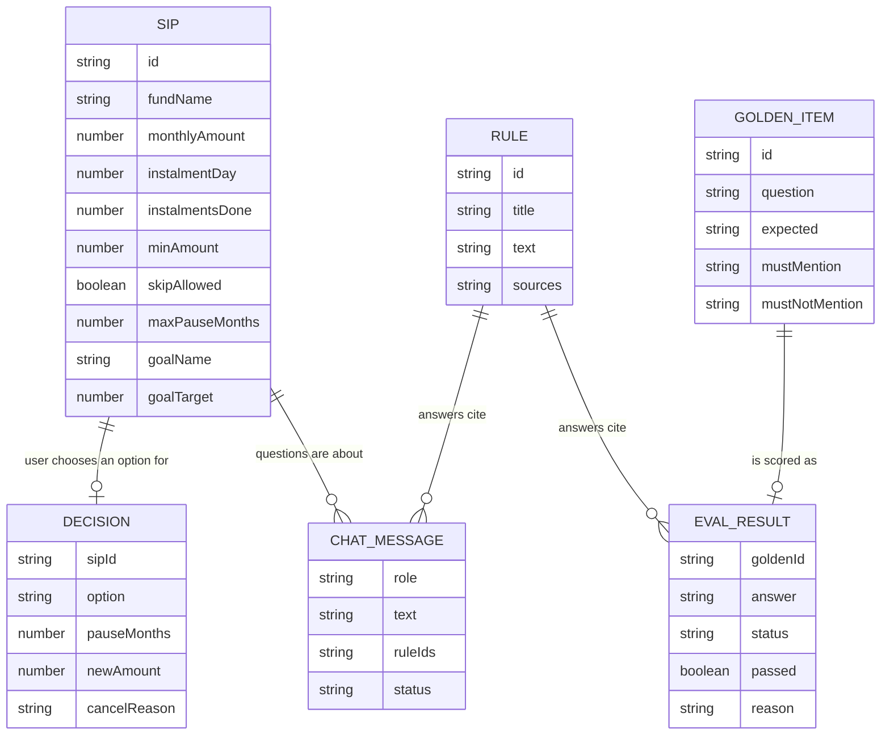

# SIP Breather: data model

The smallest set of data that supports every screen. No database: seed data lives in TypeScript files, everything the user does lives in memory for the session. Reset clears it.

Rule used: if a value can be worked out from other values, it is not stored.

## Seed data (exists before the user does anything)

### Sip (2 demo SIPs)
| field | type | required | note |
|---|---|---|---|
| id | string | yes | "sip_flexi", "sip_mid" |
| fundName | string | yes | always a "Sample …" name |
| monthlyAmount | number | yes | ₹ |
| instalmentDay | number | yes | day of month, e.g. 5 |
| instalmentsDone | number | yes | |
| minAmount | number | yes | 100 |
| skipAllowed | boolean | yes | true in demo |
| maxPauseMonths | number | yes | 3 |
| goalName | string | no | "Bike" |
| goalTarget | number | no | 60000 |

Derived, not stored: invested = monthlyAmount × instalmentsDone; goal progress = invested / goalTarget; after a date change, the next instalment is the first on the new day, or the old next instalment if the new day is less than 5 days away (R12); next instalment date = the next time instalmentDay comes round after today; last instalment date = the most recent instalmentDay before today; pause restart date = next date + pauseMonths.

### Rule (the facts GR-1 is allowed to use)
| field | type | required |
|---|---|---|
| id | string | yes |
| title | string | yes |
| text | string | yes |
| sources | {label: string, url: string}[] | yes |

12 rules (R1 to R12; R11 "Short-term returns" was added with the classic redesign and R12 "Changing the SIP date" with date changing, both 7 Nov 2026). Every rule has two sources: "AMFI investor education" (https://www.amfiindia.com/investor-corner) and "Groww Help Centre" (https://groww.in/help). Answers show them as one line: "Sources: AMFI investor education · Groww Help Centre".

Content: see ai_rules.md.

### GoldenItem (25 test questions, golden set v3)
| field | type | required |
|---|---|---|
| id | string | yes |
| question | string | yes |
| expected | "answer" \| "refuse_advice" \| "out_of_scope" | yes |
| mustMention | string[] | no |
| mustNotMention | string[] | no |
| compare | boolean | no (true for G23 to G25: asked with the default comparison for Sample Flexi Cap, pause 2 months, lower to ₹200) |

Content: see ai_rules.md. Set v1 (G1 to G20) was used for runs 1 to 4; set v2 (G1 to G22) for run 5; set v3 adds G23 to G25 (from run 6).

### Holding (2, one per SIP; Groww's existing Dashboard and redeem screens only)
| field | type | required | note |
|---|---|---|---|
| sipId | string | yes | "sip_flexi", "sip_mid" |
| currentValue | number | yes | ₹3,036 and ₹4,048 |
| oneDayChange | number | yes | ₹9 and ₹12 |

Plus constants shown as given, not worked out: portfolio XIRR "6.10%", and a sample XIRR per fund for the Dashboard rows (Flexi Cap "6.34%", Midcap "5.92%").

Derived, not stored: invested (from Sip); total current value ₹7,084; total returns = current value − invested (+₹84, 1.2%); 1D returns = sum of oneDayChange (+₹21, 0.3%); amount available to redeem = that fund's current value (classic Groww redeems one fund at a time); short-term capital gain = amount × (currentValue − invested) / currentValue; NAV date and "expected transfer" date (3 working days from today). Returns are shown only on Groww's existing screens, never on our SIP screens.

## Session data (created when the user acts, in memory only)

### Redemption (while on the redeem flow)
| field | type | required |
|---|---|---|
| sipId | string | yes (the fund being redeemed: chosen on the Dashboard, or the SIP itself for "Withdraw money, keep SIP") |
| amount | string as typed, e.g. "1000" or "250.5" | yes |

Cleared when a new redemption starts or on Reset. Dashboard holdings do not change after a redemption (demo).

### Decision (one per demo run)
| field | type | required |
|---|---|---|
| sipId | string | yes |
| option | "skip" \| "pause" \| "lower" \| "date" \| "cancel" | yes ("lower" = new amount, maybe with a new date; "date" = new date only) |
| pauseMonths | 1 \| 2 \| 3 | only for pause |
| newAmount | number | only for lower |
| newDay | number (1–28) | for "date", and for "lower" when the date changed too |
| cancelReason | "returns" \| "withdraw" \| "pause" \| "change" \| "goal" \| "other" | no (set when the option was reached from the cancel reasons) |

A skip made on the YOUR SIP card or on SIP details is also a Decision (option "skip"); the screen then shows it in place.

### Cancel reason draft (while on the cancel path)
The reason picked on "Choose your reason to cancel this SIP": "returns" \| "withdraw" \| "pause" \| "change" \| "goal" \| "other". It decides what opens next and is copied into the Decision and the test log row.

### Compare choices (while on "Compare your options")
| field | type | required |
|---|---|---|
| pauseMonths | 1 \| 2 \| 3 | yes (default 2) |
| lowerInput | string as typed, e.g. "200" | yes (default "200"; valid from ₹100 to less than the current amount) |
| compareOpened | boolean | yes (Compare was opened in this run; for the test log, cleared after each saved row) |

Kept until Reset, so going back and forth keeps the user's choices. Tapping Pause or Lower copies the choice into that option's screen.

Derived, not stored (`lib/compare.ts`, worked out the same way in the browser and on the server): for each of the five options (keep / skip / pause N months / lower to ₹X / cancel), instalments in the next 12 months (instalment dates after today, up to and including the same date next year), new-instalment money, total put in by month 12 (already invested + new instalments, no returns), SIP running at month 12, goal progress. Example, Sample Flexi Cap on 7 Nov 2026: 12 / 11 / 10 / 12 / 0 instalments; ₹9,000 / ₹8,500 / ₹8,000 / ₹5,400 / ₹3,000 by Nov 2027.

### ChatMessage
| field | type | required |
|---|---|---|
| role | "user" \| "assistant" | yes |
| text | string | yes |
| ruleIds | string[] | assistant only |
| status | "ok" \| "fallback" \| "refused" | assistant only |
| simulated | boolean | assistant only; true when "Simulate AI failure" was on |
| compareFallback | boolean | assistant only; true when the fallback is the calculated comparison ("Here are the calculated numbers") |

Where GR-1 was opened from ("redeem" \| "returns" \| "compare" \| "other") is kept in memory to choose its suggested questions; it is not part of a message. When it is "compare", each question sends only the two Compare choices and today's date; the server recalculates the results.

### EvalResult (one per golden item, when "Run evaluation" is pressed)
| field | type | required |
|---|---|---|
| goldenId | string | yes |
| answer | string | yes |
| type | "answer" \| "refuse_advice" \| "out_of_scope" \| null (safe fallback) | yes |
| status | "ok" \| "fallback" \| "refused" | yes |
| passed | boolean | yes |
| reason | string | yes |

Derived, not stored: score, advice leaks count, refusal accuracy. The saved run (`eval/last_run.json`) also records `goldenSet` ("v2" for run 5, "v3" from run 6 on).

## Browser-only data (PM-approved exception: survives reloads, never leaves the browser)

### TestLogRow (one each time a run finishes; localStorage, Clear empties it)
A run finishes at a Done screen, at "Redemption placed", when a skip is confirmed on SIP details, or with "Keep as is" on Compare. Stored under a new key since the classic redesign; older rows are not shown.

| field | type | required |
|---|---|---|
| time | ISO timestamp | yes |
| device | "iphone" \| "pixel" \| "frameless" | yes |
| entry | "redeem" \| "cancel" \| "sip_details" | yes (where the run started) |
| cancelReason | "returns" \| "withdraw" \| "pause" \| "change" \| "goal" \| "other" | only when entry is "cancel" |
| finalChoice | "redeem_only" \| "keep" \| "skip" \| "pause" \| "lower" \| "date" \| "cancel" | yes ("keep" = "Keep as is" on Compare; "lower" also when the date changed too) |
| compareOpened | boolean | yes (Compare was opened in this run; rows saved before Compare existed have none) |
| pauseMonths | 1 \| 2 \| 3 | only for pause |
| newAmount | number | only for lower |
| newDay | number (1–28) | when the SIP date was changed |
| redeemAmount | number | only when a redemption was placed |
| gr1Questions | number | yes (since the last Reset) |

## Diagram

