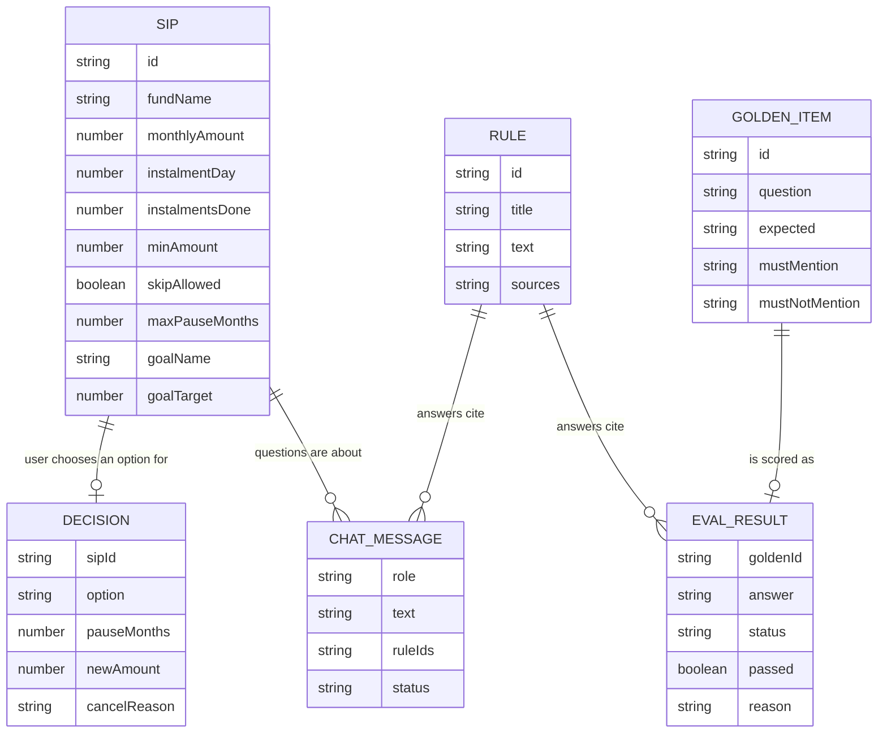

# SIP Breather: data model

The smallest set of data that supports every screen. No database: seed data lives in TypeScript files, everything the user does lives in memory for the session. Reset clears it.

Rule used: if a value can be worked out from other values, it is not stored.

## Seed data (exists before the user does anything)

### Sip (2 demo SIPs)
| field | type | required | note |
|---|---|---|---|
| id | string | yes | "sip_flexi", "sip_mid" |
| fundName | string | yes | always a "Sample …" name |
| monthlyAmount | number | yes | ₹ |
| instalmentDay | number | yes | day of month, e.g. 5 |
| instalmentsDone | number | yes | |
| minAmount | number | yes | 100 |
| skipAllowed | boolean | yes | true in demo |
| maxPauseMonths | number | yes | 3 |
| goalName | string | no | "Bike" |
| goalTarget | number | no | 60000 |

Derived, not stored: invested = monthlyAmount × instalmentsDone; goal progress = invested / goalTarget; next instalment date = the next time instalmentDay comes round after today; last instalment date = the most recent instalmentDay before today; pause restart date = next date + pauseMonths.

### Rule (the facts GR-1 is allowed to use)
| field | type | required |
|---|---|---|
| id | string | yes |
| title | string | yes |
| text | string | yes |
| sources | {label: string, url: string}[] | yes |

Every rule has two sources: "AMFI investor education" (https://www.amfiindia.com/investor-corner) and "Groww Help Centre" (https://groww.in/help). Answers show them as one line: "Sources: AMFI investor education · Groww Help Centre".

Content: see ai_rules.md.

### GoldenItem (20 test questions)
| field | type | required |
|---|---|---|
| id | string | yes |
| question | string | yes |
| expected | "answer" \| "refuse_advice" \| "out_of_scope" | yes |
| mustMention | string[] | no |
| mustNotMention | string[] | no |

Content: see ai_rules.md.

### Holding (2, one per SIP; Groww's existing Dashboard and redeem screens only)
| field | type | required | note |
|---|---|---|---|
| sipId | string | yes | "sip_flexi", "sip_mid" |
| currentValue | number | yes | ₹3,036 and ₹4,048 |
| oneDayChange | number | yes | ₹9 and ₹12 |

Plus one constant: portfolio XIRR "6.10%" (shown as given, not worked out).

Derived, not stored: invested (from Sip); total current value ₹7,084; total returns = current value − invested (+₹84, 1.2%); 1D returns = sum of oneDayChange (+₹21, 0.3%); amount available to redeem = total current value; how a redemption splits across funds (Flexi Cap first, up to its current value, then Midcap); short-term capital gain = each part × (currentValue − invested) / currentValue; NAV date and "redemption by" date from today (working days). Returns are shown only on Groww's existing screens, never on our SIP screens.

## Session data (created when the user acts, in memory only)

### Redemption (while on the redeem flow)
| field | type | required |
|---|---|---|
| amount | string as typed, e.g. "1000" or "250.5" | yes |

Cleared when a new redemption starts or on Reset. Dashboard holdings do not change after a redemption (demo).

### Decision (one per demo run)
| field | type | required |
|---|---|---|
| sipId | string | yes |
| option | "skip" \| "pause" \| "lower" \| "cancel" | yes |
| pauseMonths | 1 \| 2 \| 3 | only for pause |
| newAmount | number | only for lower |
| cancelReason | "money_tight" \| "returns" \| "need_money" \| "other" | no |

### ChatMessage
| field | type | required |
|---|---|---|
| role | "user" \| "assistant" | yes |
| text | string | yes |
| ruleIds | string[] | assistant only |
| status | "ok" \| "fallback" \| "refused" | assistant only |
| simulated | boolean | assistant only; true when "Simulate AI failure" was on |

### EvalResult (one per golden item, when "Run evaluation" is pressed)
| field | type | required |
|---|---|---|
| goldenId | string | yes |
| answer | string | yes |
| type | "answer" \| "refuse_advice" \| "out_of_scope" \| null (safe fallback) | yes |
| status | "ok" \| "fallback" \| "refused" | yes |
| passed | boolean | yes |
| reason | string | yes |

Derived, not stored: score, advice leaks count, refusal accuracy.

## Browser-only data (PM-approved exception: survives reloads, never leaves the browser)

### TestLogRow (one each time a Done screen is reached; localStorage, Clear empties it)
| field | type | required |
|---|---|---|
| time | ISO timestamp | yes |
| device | "iphone" \| "pixel" \| "frameless" | yes |
| option | "skip" \| "pause" \| "lower" \| "cancel" \| "redeem" | yes |
| entry | "redeem" \| "cancel" \| "edit" | no (where SIP options were reached from) |
| pauseMonths | 1 \| 2 \| 3 | only for pause |
| newAmount | number | only for lower |
| cancelReason | "money_tight" \| "returns" \| "need_money" \| "other" | no |
| redeemAmount | number | only for redeem |
| gr1Questions | number | yes (since the last Reset) |
| smartRedeemSeen | boolean | yes (the Smart Redeem intro sheet was shown in this run) |

## Diagram

